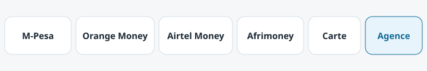
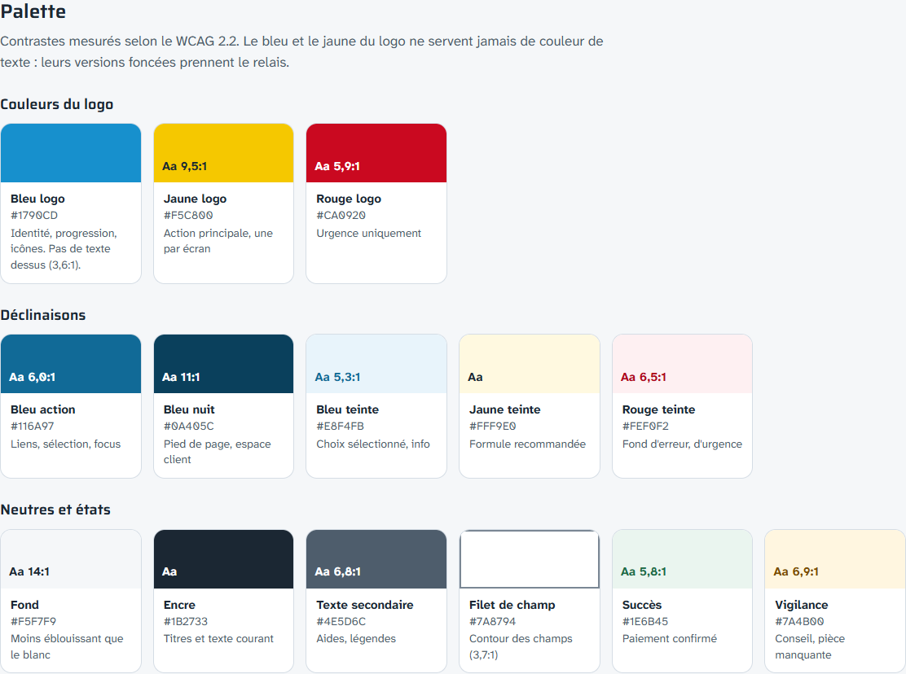
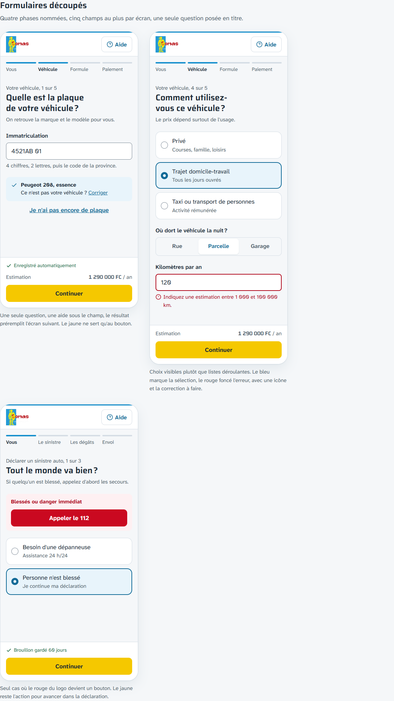
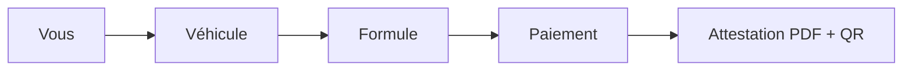

<p align="center">
  
</p>

<p align="center">
  <strong>Plateforme web de souscription d’assurances SONAS</strong> en République démocratique du Congo.<br>
  Devis instantané · paiement mobile money · attestation PDF + QR · sinistre · agences
</p>

<p align="center">
  <a href="DESIGN.md">Charte</a> ·
  <a href="docs/descriptif.md">Brief</a> ·
  <a href="docs/recherche_formulaires_rdc.md">Formulaires RDC</a> ·
  <a href="docs/benchmark_concurrents.md">Benchmark</a> ·
  <a href="https://www.sonas.cd/">sonas.cd</a>
</p>

---

Aujourd’hui, aucun assureur en RDC n’offre un parcours web complet **devis → souscription → paiement → attestation**. myVign vise cet espace, pour le compte de la SONAS.

L’ergonomie s’aligne sur [macif.fr](https://www.macif.fr/) et [agences.macif.fr](https://agences.macif.fr/). Les couleurs viennent du **logo SONAS** (bleu, jaune, rouge), pas de la palette verte des maquettes mobiles.

## Produits

<p align="center">
  
</p>

| Branche | Mode visé |
|---|---|
| Auto | Devis et souscription en ligne |
| Habitation / incendie | En ligne (incendie obligatoire, art. 210 CA) |
| Voyage, scolaire | En ligne |
| Transport, entreprise | Questionnaire court, puis rappel conseiller |

<p align="center">
  
</p>

## Charte visuelle

Un seul bouton jaune par écran. Le rouge est réservé à l’urgence (112). Le reste est neutre, pour reposer l’œil.

<p align="center">
  
</p>

Référence complète : [DESIGN.md](DESIGN.md) · aperçu HTML : [docs/design/apercu-charte.html](docs/design/apercu-charte.html)

## À quoi ressemblent les écrans

Quatre phases, **un sujet par écran**, cinq champs visibles au maximum, pied collant (prix + bouton jaune).

<p align="center">
  
</p>

<table>
  <tr>
    <td width="33%" valign="top" align="center">
      <br>
      <sub>Plaque → préremplissage du véhicule</sub>
    </td>
    <td width="33%" valign="top" align="center">
      <br>
      <sub>Choix visibles, erreur explicite</sub>
    </td>
    <td width="33%" valign="top" align="center">
      <br>
      <sub>Seul cas avec bouton rouge</sub>
    </td>
  </tr>
</table>

### Parcours auto



1. **Vous** — conducteur, identité, pièce, contact, permis  
2. **Votre véhicule** — plaque ou châssis, carte rose, usage, antécédents  
3. **Votre formule** — Tiers / Tiers étendu / Tous risques, options  
4. **Paiement** — récapitulatif, mobile money, certification d’exactitude  

La couverture commence **après paiement** (Code des assurances, art. 16). Certificat provisoire immédiat ; définitif via le SNECA.

## Architecture

<p align="center">
  
</p>

```
myVign/
├── web/                      # App Next.js (App Router)
├── packages/
│   ├── contracts/            # Schémas Zod, routes, client typé
│   └── config/               # TypeScript partagé
├── docs/                     # Besoins RDC, benchmark, visuels README
├── DESIGN.md                 # Système de design (obligatoire pour l’UI)
└── pnpm-workspace.yaml
```

Le contrat d’API (`@myvign/contracts`, v1.0.0) est la source de vérité : front, futur back et tests s’alignent dessus.

### État du dépôt

| Partie | État |
|---|---|
| Charte et aperçu HTML | Définis |
| Recherche métier (`docs/`) | Disponible |
| Contrat d’API | Schémas Zod, routes `/v1`, parcours auto |
| Tarif simulé, référentiels, agences | Présents dans `web/src` |
| Interface Next.js | Échafaudage, pages métier non branchées |
| API Nest, mock HTTP, infra Docker | Annoncés dans les scripts, pas encore en place |

## Démarrer

**Prérequis :** Node.js ≥ 22.12 · pnpm 11

```bash
pnpm install
pnpm dev          # Next.js → http://localhost:3000
pnpm build
pnpm typecheck
pnpm lint         # Biome
pnpm format
```

Autres scripts racine (cibles encore incomplètes) : `pnpm mock`, `pnpm openapi`, `pnpm infra:up`.

## Documentation

| Fichier | Contenu |
|---|---|
| [docs/descriptif.md](docs/descriptif.md) | Brief produit |
| [DESIGN.md](DESIGN.md) | Couleurs, typo, anatomie des écrans |
| [docs/design/apercu-charte.html](docs/design/apercu-charte.html) | Charte en situation |
| [docs/recherche_formulaires_rdc.md](docs/recherche_formulaires_rdc.md) | Champs, pièces, règles légales |
| [docs/benchmark_concurrents.md](docs/benchmark_concurrents.md) | Offre digitale des assureurs RDC |
| [docs/Etude_marche_SONAS.docx](docs/Etude_marche_SONAS.docx) | Étude de marché |
| [docs/readme/](docs/readme/) | Visuels de ce README |
